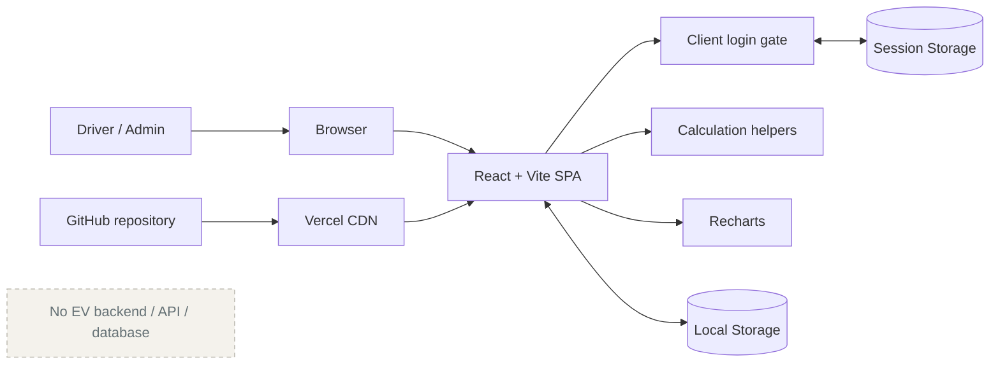
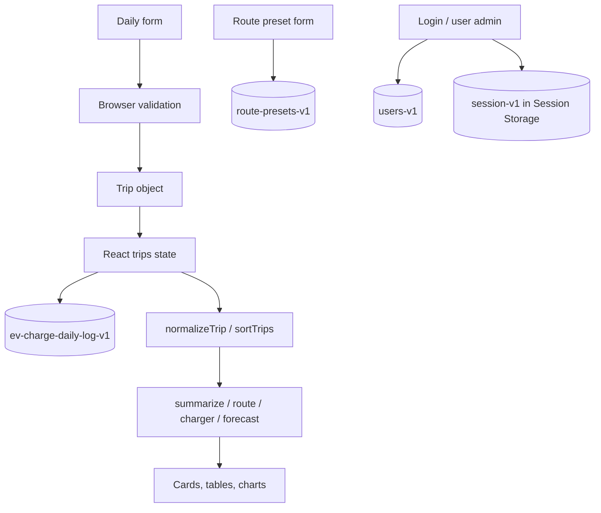
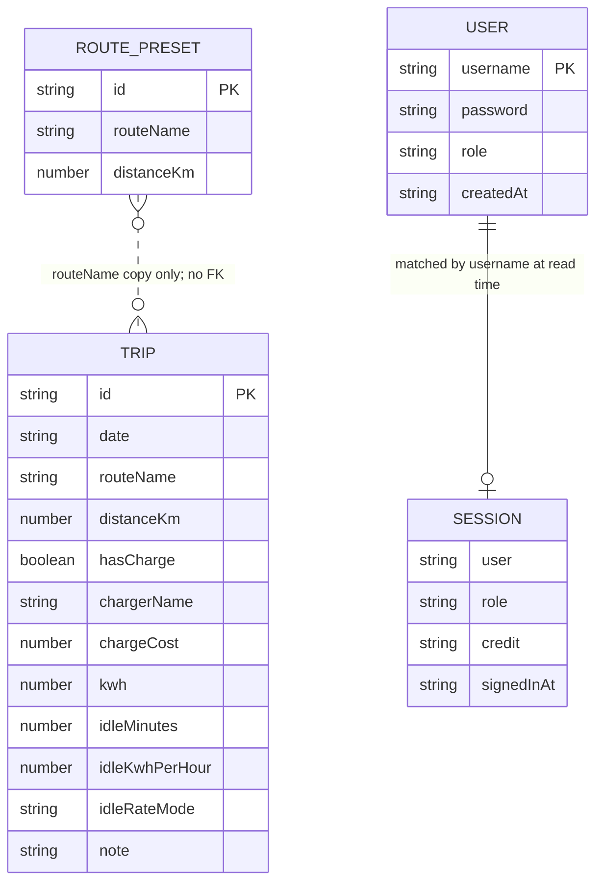

# System Architecture

## Runtime Architecture



Source: [`diagrams/system-architecture.mmd`](diagrams/system-architecture.mmd).

## Component Responsibilities

| Layer | Files | Responsibility |
| --- | --- | --- |
| Shell/state | `src/App.jsx` | tab selection, trip state, session gate, persistence |
| Input | `DailyLog.jsx`, `RoutePresetManager.jsx`, `UserManagement.jsx` | browser-local mutations |
| Analytics | `src/utils/calculations.js` | normalization, grouping, metrics, forecast |
| Views | weekly/monthly/route/charging/forecast components | presentation and filters |
| Charts | `Charts.jsx` | bar, line, pie visualization |
| Persistence | `tripStorage.js`, `auth.js`, `routePresets.js` | Local/Session Storage access; trips are never overwritten without a copy |
| Warnings | `StorageNotice.jsx` | unreadable-data and save-failure banner |
| Integrity | `licenseGuard.js`, `brandAudit.js` | client-side credit/version/palette equality checks |

## Data Flow



Source: [`diagrams/data-flow.mmd`](diagrams/data-flow.mmd).

## Sitemap / Information Architecture

All screens use `/`; tabs are React state, not URL routes.

```mermaid
flowchart TD
  ROOT[/] --> LOCK{License check}
  LOCK -->|fail| L[License Lock]
  LOCK -->|pass| SESSION{Session exists}
  SESSION -->|no| LOGIN[Login]
  SESSION -->|yes| PW{Default password?}
  PW -->|yes| CHPW[Set New Password]
  CHPW --> APP
  PW -->|no| APP[App shell]
  APP --> D[Daily Log]
  APP --> W[Weekly Dashboard]
  APP --> M[Monthly Dashboard]
  APP --> R[Route Analysis]
  APP --> C[Charging Analysis]
  APP --> F[Forecast]
  APP --> U[Users - admin only]
```

Source: [`diagrams/sitemap.mmd`](diagrams/sitemap.mmd).

## Storage Relationship Diagram

There is no database. This conceptual model represents independent browser keys.



Source: [`diagrams/storage-model.mmd`](diagrams/storage-model.mmd).

## Hosting and CI/CD

- Vercel project linkage: project name `evpower` is verified locally.
- `vercel.json`: install `npm install`, build `npm run build`, output `dist`, framework `vite`.
- Automated CI workflow: NOT FOUND.
- GitHub Actions: NOT FOUND.
- Production promotion policy: NOT VERIFIED.
- Repository visibility: public (verified 2026-10-28) - everything in source, including the default login credential, is world-readable.

## Build Pipeline (verified 2026-10-28)

`index.html` -> `src/main.jsx` (Vite + `@vitejs/plugin-react`) -> `src/index.css` -> `postcss.config.mjs` (`@tailwindcss/postcss`) -> `dist/assets/*.js|css`. `public/*` is copied verbatim to `dist/`.

